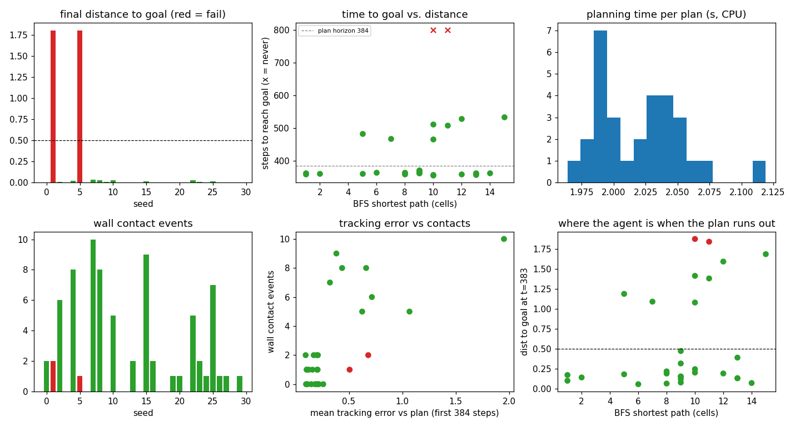
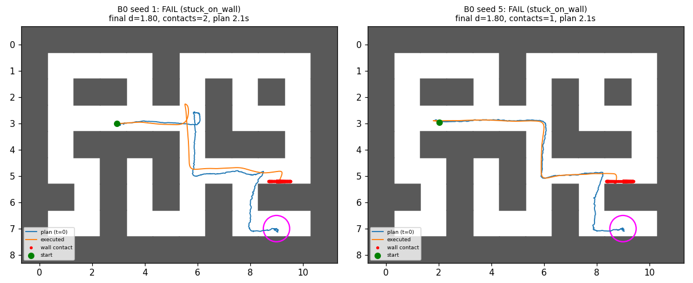

# B0 Baseline — frozen Diffuser, plan once, no obstacle

| | |
|---|---|
| **Status** | Done (2026-11-09). All acceptance criteria passed |
| **Project step** | Step 1 of the roadmap (risk R1 check: "Large runs, weights load, 30 obstacle-free runs") |
| **Result** | **28/30 success (93.3%, 95% CI 78.7–98.2%)**, 2.0 s per plan on CPU, bit-reproducible |
| **Run everything** | `bash experiments/b0_baseline/run_all.sh` (≈ 3 min on CPU) |

---

## 1. Background and motivation

Our project ("Training-Free Rerouting of a Pretrained Diffuser in Blocked Mazes") compares four planning loops wrapped around the **same frozen Diffuser**: B0 → B1 → B2 → ours. Each adds one component. **B0 is the bottom of that ladder.** It is Diffuser exactly as published for Maze2D: sample one 384-step plan at t = 0 (start and goal fixed by inpainting), then follow it with a simple waypoint controller and never replan.

Before measuring what happens when a corridor gets blocked, we need to know what B0 does in the **unblocked** maze:

* the environment, weights and control loop work on our machines;
* the success ceiling, so later drops can be attributed to the obstacle rather than to Diffuser itself;
* the cost of one plan, which sets the compute budget for B1/B2 (risk R5);
* how and why B0 fails without any obstacle, so those failures aren't later credited to obstacle handling.

## 2. Objectives — questions this experiment answers

| # | Question | How it is answered |
|---|---|---|
| Q1 | Does the frozen model run end to end in our env, reproducibly? | smoke test + bit-level repro check |
| Q2 | Obstacle-free success rate on maze2d-large-v1 with a fixed goal? | 30 seeded episodes, Wilson 95% CI |
| Q3 | Final distance, path length, wall contacts and planning time? | per-episode metrics → `summary.json` |
| Q4 | Why do failures happen? | rule-based failure label + per-episode plots |
| Q5 | What does B0 imply for scenario design in Step 2 (obstacle timing, detour budget)? | plan/agent timing analysis (F1, F2 below) |

**Expected before running:**
- High success: the paper reports a 123 normalized score on Large, with near-perfect success.
- About 1–2 s per plan.
- Wall contacts that are common but mostly harmless (the proposal already plans to report them separately).

## 3. Implementation

The original Diffuser code (`diffuser/`, `scripts/`, `config/`) is **not changed by this experiment**. The only edits to it ever made are the four CPU/WSL compatibility edits in the repo's initial commit. They replace hard-coded `cuda:0` with the configured device and are device-only, with no algorithmic change:

- `diffuser/guides/policies.py`
- `diffuser/utils/serialization.py`
- `diffuser/utils/training.py`
- `scripts/plan_maze2d.py`

New files:

| File | Purpose |
|---|---|
| `experiments/common/env/wsl_env.sh` | Sets up the runtime (Python 3.8 env, MuJoCo 2.0, OSMesa, D4RL data dir). Every path can be overridden per machine |
| `experiments/common/env/run.sh` | Runs a command inside that environment from the repo root |
| `experiments/common/env/check_env.py` | Checks imports, the env, the dataset and the weights |
| `experiments/common/planner.py` | `FrozenDiffuserPlanner.plan(obs, goal, n)` → n plans + wall-clock time. Uses the original `Policy` with `cond = {0: obs, H-1: [goal, 0, 0]}`. `waypoint_action()` is the original `plan_maze2d.py` controller. **Shared interface for B1/B2/ours** |
| `experiments/common/maze_utils.py` | qpos↔cell mapping, BFS shortest path (with `blocked` cells, ready for obstacles), plan-in-wall checks, MuJoCo wall-contact detection, maze drawing |
| `experiments/common/check_geometry.py` | Pushes the ball into walls and checks the contact positions against `maze_utils`' geometry |
| `experiments/b0_baseline/run_b0.py` | The B0 episode loop and per-episode metrics/plots |
| `experiments/b0_baseline/check_repro.py` | Compares two runs: plans and rollouts must be bit-identical, and every metric except timing must match |
| `experiments/b0_baseline/analyze_b0.py` | Aggregates results to CSV/JSON/figures and evaluates the acceptance criteria |
| `experiments/b0_baseline/configs/{smoke,main}.json` | Run configurations (seeds, device, threads, output dir) |
| `experiments/b0_baseline/run_all.sh` | The whole pipeline, in order |

**Coordinate convention (verified).** d4rl places wall cell (i, j) at world (i+1, j+1), and the ball body at world (1.2, 1.2) + qpos. So in observation coordinates, cell (i, j) covers [i−0.7, i+0.3] × [j−0.7, j+0.3]. Diffuser's own renderer assumes ±0.5, which is off by 0.2; this matters for collision checks, not for B0. `check_geometry.py` confirms it to within 0.035 (the residual is MuJoCo contact margin).

## 4. Procedure, metrics and acceptance criteria

### Procedure
1. **Environment and geometry checks.**
2. **Smoke test:** seeds 0 and 1. Confirms the pipeline runs and measures time per episode.
3. **Reproducibility:** the same seeds again in a new process, compared bit for bit.
4. **Main run:** seeds 0–29, 30 episodes.
5. **Analysis.**

### What varies
Only the **seed**, which sets `random`, `numpy`, `torch` and `env.seed`. The seed determines:
- the start position: `env.reset()` picks a free cell uniformly at random, plus U(−0.1, 0.1) jitter and a small random initial velocity;
- the diffusion sampling noise.

Fixed: environment `maze2d-large-v1`, goal (7, 9), horizon H = 384, T = 256 diffusion steps, checkpoint epoch 1,960,000, 800-step limit, CPU with 8 torch threads, no obstacle.

### Episode loop
`obs = env.reset()` → one plan `plan(obs, goal, n=1)` → for t = 0…799: `action = waypoint_action(plan, t, state)`, `env.step(action)`.

The controller tracks plan point t+1. After the plan is used up (t ≥ 383), it steers straight at the plan's last point (the goal). This fallback is part of the original code and we keep it.

### Success and failure
* **Success:** the ball comes within **0.5** of the goal at any step within 800 steps (proposal definition; in Step 1 there is no obstacle to collide with). We also record whether it was still inside at t = 800 (`success_at_end`).
* **Failure label** (rule-based, checked in this order):
  1. `plan_through_wall`: a plan point lies inside a wall cell.
  2. `stuck_on_wall`: the ball moved < 0.1 in the last 100 steps and touched a wall during them.
  3. `stalled_off_goal`: stalled without wall contact.
  4. `timeout_still_moving`.

### Metrics (per episode → `episodes.csv`)
| Group | Columns |
|---|---|
| Outcome | `success`, `first_success_step`, `final_dist_to_goal`, `min_dist_to_goal`, `success_at_end`, `reached_then_left`, `failure_reason`, `d4rl_normalized_score` |
| Cost | `planning_time_s` (one `Policy` call), `n_plans`, `n_replans` (= 0), `episode_time_s` |
| Path | `path_length`, `path_length_to_success`, `plan_path_length`, `shortest_path_cells` (BFS), `plan_detour_cells` |
| Contacts | `wall_contact_events` (number of separate contacts), `wall_contact_steps`, `obstacle_collisions` (= 0, kept for schema) |
| Diagnostics | `plan_first_reach_idx`, `plan_wall_points` (centre in wall), `plan_wall_touch_points` (ball would overlap a wall), `track_err_mean_first_H`, `dist_to_goal_at_plan_end`, `stall_start_step` |

### Acceptance criteria (checked automatically by `analyze_b0.py` → `summary.json["acceptance"]`)
| Criterion | Result |
|---|---|
| all 30 episodes complete | ✅ |
| every key metric recorded for every episode | ✅ |
| success rate ≥ 80% (a meaningful reference ceiling) | ✅ 93.3% |
| every failure has a named cause | ✅ |
| same seed → bit-identical plan and rollout | ✅ |

## 5. Reproducing

### 5.1 Environment used for these results
| Item | Value |
|---|---|
| OS | Windows 10 + WSL2 Ubuntu (CPU run; GPU not used) |
| Python | 3.8.20 (micromamba env at `~/.local/share/ece780-diffuser/env`) |
| torch | 1.9.1+cpu, 8 threads |
| mujoco-py / MuJoCo | 2.0.2.13 / mujoco200 (+ `mjkey.txt`), OSMesa CPU rendering |
| gym / d4rl | 0.18.0 / Farama d4rl @ `f2a05c0` (installed `--no-deps`) |
| numpy | 1.23.5 |
| Weights | `logs/maze2d-large-v1/diffusion/H384_T256/state_1960000.pt` (released Diffuser Maze2D weights) |
| Dataset | `maze2d-large-sparse-v1.hdf5` in `$D4RL_DATASET_DIR` |

### 5.2 Setting up a new machine (Linux or WSL)
Weights, the dataset and the conda env are **not in git**; they are large. Steps:

1. **Python env.** Follow the team's install recipe (`Diffuser_Maze2D_Large_原版跑通.ipynb`, sections 1–4):
   - Python 3.8 plus `pip==23.0.1 setuptools==65.5.0 wheel==0.38.4 "Cython<3" numpy==1.23.5`;
   - `gym==0.18.0` and `mujoco-py==2.0.2.13`, both with `--no-build-isolation`;
   - `torch==1.9.1`;
   - `matplotlib==3.3.4 typed-argument-parser einops gitpython imageio scikit-video==1.1.11 h5py pandas "Pillow==7.2.0"`;
   - `mjrl` and `d4rl@f2a05c0d`, both `--no-deps`.
2. **MuJoCo 2.0.** `~/.mujoco/mujoco200` + `~/.mujoco/mjkey.txt` (from roboti.us). You also need OSMesa headers and libraries (`libosmesa6-dev`, or a local bundle).
3. **Weights.** Download `maze2d-logs.zip` (Dropbox link in the notebook, section 6) and unzip it so that `logs/maze2d-large-v1/diffusion/H384_T256/` exists inside this repo.
4. **Dataset.** D4RL downloads it automatically on first use into `$D4RL_DATASET_DIR`. Or copy the existing `maze2d-large-sparse-v1.hdf5`.
5. **Point the scripts at your paths.** Export any of `ECE780_ENV`, `ECE780_OSMESA`, `MUJOCO_PY_MUJOCO_PATH`, `D4RL_DATASET_DIR` before running, or edit the defaults in `experiments/common/env/wsl_env.sh`.
6. **Check:**
   ```bash
   bash experiments/common/env/run.sh python experiments/common/env/check_env.py
   ```
   It should print `ALL OK`.

> Gotcha we hit: if `mujoco_py` prints *"Import error. Trying to rebuild mujoco_py"* and then fails with `GL/osmesa.h: No such file`, the prebuilt extension is fine but cannot load `libLLVM`/`libOSMesa`. Put the OSMesa `lib/x86_64-linux-gnu` directory on `LD_LIBRARY_PATH`; `wsl_env.sh` does this.

### 5.3 Commands
From the repo root, inside Linux/WSL:
```bash
bash experiments/b0_baseline/run_all.sh
```
Or step by step:
```bash
bash experiments/common/env/run.sh python experiments/b0_baseline/run_b0.py --config experiments/b0_baseline/configs/smoke.json
```
```bash
bash experiments/common/env/run.sh python experiments/b0_baseline/run_b0.py --config experiments/b0_baseline/configs/main.json
```
```bash
bash experiments/common/env/run.sh python experiments/b0_baseline/analyze_b0.py experiments/b0_baseline/results/main
```
From Windows Git Bash, prefix with `MSYS_NO_PATHCONV=1 wsl -d Ubuntu -- bash "/mnt/d/.../diffuser/experiments/b0_baseline/run_all.sh"`. The quotes matter because the path contains spaces.

Extra seeds without editing configs: `run_b0.py --config ... --seeds 30 31 32 --out experiments/b0_baseline/results/extra`.

### 5.4 Outputs
```
results/
  smoke/  episodes/seed00{0,1}[_rep].{json,npz,png}, run_meta*.json, repro_check.json
  main/   episodes/seedNNN.{json,npz,png}   one per episode (npz = full plan + rollout + contacts)
          episodes.csv        one row per episode, all metrics
          summary.json        aggregate stats, failure list, acceptance checks, git commit
          by_start_cell.csv   success / timing per start cell
          b0_overview.png     6-panel overview (distance, timing, planning time, contacts, tracking)
          b0_start_cells.png  success by start cell on the maze
          b0_failures.png     the failure episodes side by side
          run_meta.json       config, seeds, model/torch versions, git commit
```

## 6. Results (actual, n = 30, seeds 0–29)

| Metric | Value |
|---|---|
| Success rate | **28/30 = 93.3%** (Wilson 95% CI 78.7–98.2%) |
| Still at goal at t = 800 | 93.3% (no episode reached the goal and then left) |
| Final distance to goal | median 0.003, mean 0.128; the two failures both end at **1.80** |
| Steps to reach goal (successes) | median 362, mean 396, range 355–534 |
| Planning time | **2.00 ± 0.02 s** per plan (CPU, 8 threads); model load ≈ 12.5 s; full 30-episode run 79 s |
| Executed path length | mean 12.4 (to success 11.8); plan path length 16.0 |
| Wall contacts | 20/30 episodes; mean 2.5 events/episode (max 10); successes 2.6, failures 1.5 |
| Obstacle collisions | 0 (no obstacle) |
| Failure reasons | `stuck_on_wall` × 2 (seeds 1 and 5, start cells (3,3) and (3,2)) |
| Plan quality | 1/30 plans with points inside a wall (seed 22, still succeeded); 8/30 where the ball would graze a wall |
| D4RL normalized score | 138.9 mean (paper: 123.0; different n and reset protocol, so only a sanity check) |
| Reproducibility | seeds 0 and 1: identical across 3 separate processes; all 30 seeds identical between the prototype and the final scripts |



### Analysis

**F1 — Plans always arrive at about step 360, whatever the distance.** Every plan first enters the goal radius at plan index 353–361. Its correlation with the BFS start–goal distance is 0.02. A start 1 cell away and one 15 cells away both arrive at about step 360. Diffuser stretches every route over its fixed 384-step horizon. The ball could physically move faster: the fastest episode needed 26 steps per cell.
→ *Arrival time is set by the horizon, not by the route.* A replan with H = 384 at step t arrives at about t + 360, so any replan after t ≈ 440 cannot finish within 800 steps.

**F2 — The only failure mode: the plan runs out, then the ball gets pinned on a wall.** In 9/30 episodes the ball lagged its plan (tracking error at corners) and was still > 0.5 from the goal when the plan ended at t = 383. From then on the controller drives straight at the goal; 7 of those 9 still made it. The two failures came along row 5. From there the straight line passes through wall cell (6, 9), and the ball stops on top of that wall, directly above the goal. That is why both final distances are 1.80. Both plans were valid.



**F3 — Wall contact is routine and does not predict failure.** 19 of the 28 successes touched a wall. Contacts correlate with tracking error (r = 0.70) rather than with outcome.

**F4 — Plans are noisy.** Plans are 36% longer than the executed paths because of sampling jitter, and some graze or cut wall corners. The controller smooths this out.

**F5 — Planning cost is low and very stable** (σ = 0.02 s).

## 7. Did the results meet expectations?

| Expectation | Outcome |
|---|---|
| Pipeline runs and is reproducible | ✅ met: bit-identical across processes |
| High obstacle-free success | ✅ met: 93.3%, slightly below "near-perfect" |
| ~1–2 s per plan | ✅ met: 2.0 s on CPU |
| Wall contacts frequent but harmless | ✅ met (F3) |
| Failures, if any, come from Diffuser's plan | ❌ **unexpected:** both failures come from open-loop tracking plus the end-of-plan fallback, not from bad plans (F2) |
| Travel time scales with distance | ❌ **unexpected:** fixed at ~360 steps (F1) |

**Limitations**
- No obstacle in this step.
- 30 episodes give a wide CI.
- Only 21 of ~47 free start cells were sampled, so per-cell numbers are anecdotal.
- CPU only. GPU determinism and speed were not measured; the cu111 torch build very likely does not support the RTX 5080 (untested).
- Failure labels are heuristic rules.
- Batched best-of-N timing (N > 1) has not been measured.

## 8. Consequences for the next steps

1. **Step 2 (B0 with a mid-episode blockage).** Use `maze_utils.bfs_path(..., blocked=...)` for the detour/scenario filter. Pick appearance times while the ball is still travelling (roughly t ∈ [50, 300]). Use the ~360-steps-per-plan pacing (F1), not physical speed, when deciding whether a detour can be completed (risk R3).
2. **Fair comparison.** Report each method's obstacle-free success next to its blocked-corridor success, and attribute failures to the obstacle vs. tracking/walls. Any replanning (B1/B2) also removes F2, which is not an obstacle-handling gain.
3. **Collision checker.** Inflate plan points by the ball radius (0.1); expect some false alarms from jittery plans (F4).
4. **Before B1/B2:** measure `plan(..., n=4/16)` time.
5. **Subgoal chaining** probably needs a horizon scaled to the leg length (F1), not two full 384-step legs.
