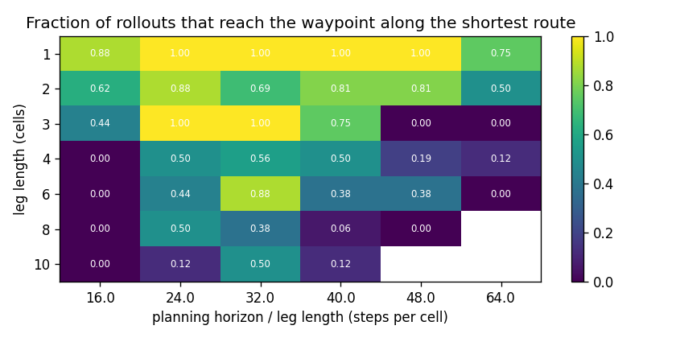

# R3 / R5 — short planning horizons and batch cost

| | |
|---|---|
| **Status** | Done (2026-11-17), CPU run in a Linux VM |
| **Project step** | Risks R3 (subgoal chaining runs out of time) and R5 (compute) |
| **Result** | Short horizons work at **24–32 steps per cell**. Straight legs succeed 40/40; legs with turns fail often because plans cut through walls. `plan(n=16)` costs 24–33 s on CPU |
| **Run everything** | `bash experiments/r3_horizon/run_all.sh` (about 30 min on CPU) |

## Why

B0 showed that a 384-step plan arrives at about step 360 whatever the distance (B0 README, F1). Two full-length legs do not fit in an 800-step episode, so each waypoint leg needs a shorter horizon. The model was trained only with H = 384.

What the code allows: the Large U-Net (`dim_mults = (1, 4, 8)`) downsamples twice and has no positional embedding along the plan, so any horizon that is a multiple of 4 runs. `FrozenDiffuserPlanner.plan(..., horizon=h)` calls the unchanged sampler with a shorter sequence. Whether those plans are any good is what this experiment measures.

## What it does

1. **Horizon sweep.** 28 start/goal cell pairs, 4 for each shortest-path length d ∈ {1, 2, 3, 4, 6, 8, 10}. For each pair, H = ratio × d for ratio ∈ {16, 24, 32, 40, 48, 64} steps per cell (rounded up to a multiple of 4, capped at 384), plus H = 384. Each plan (4 samples per pair and horizon) starts at the start cell centre at rest and is executed with the original controller for H + 60 steps.
2. **Batch timing.** Wall-clock time of `plan(n, H)` for n = 1, 4, 8, 16.

A rollout is **good** if the ball comes within 0.5 of the goal cell centre (it is inside the cell) and visited no more cells than a shortest route has.

## Results

### Steps per cell (all 28 pairs)

| Steps per cell | Samples | Good | Reached | On a shortest route | Plans with a point inside a wall | First-step jump (median) |
|---|---|---|---|---|---|---|
| 16 | 112 | 28% | 28% | 100% | 57% | 0.56 |
| 24 | 112 | 63% | 63% | 100% | 41% | 0.33 |
| **32** | 112 | **71%** | 76% | 93% | 29% | 0.25 |
| 40 | 112 | 52% | 85% | 66% | 27% | 0.16 |
| 48 | 96 | 40% | 80% | 56% | 35% | 0.17 |
| 64 | 80 | 28% | 85% | 40% | 31% | 0.14 |

### Leg shape (ratios 24 and 32 together)

| Turns on the shortest route | Pairs | Samples | Good | Plans with a point inside a wall |
|---|---|---|---|---|
| 0 (straight) | 5 | 40 | **100%** | 20% |
| 1 | 12 | 96 | 80% | 32% |
| 2 | 4 | 32 | 47% | 38% |
| 3 | 5 | 40 | 30% | 48% |
| 4 | 2 | 16 | 44% | 56% |

### Batch timing (CPU, 8 threads, inside the VM)

| Horizon | n = 1 | n = 4 | n = 8 | n = 16 |
|---|---|---|---|---|
| 64 | 1.8 s | 6.1 s | 11.3 s | 23.7 s |
| 128 | 2.0 s | 8.0 s | 13.9 s | 25.8 s |
| 384 | 3.6 s | 9.5 s | 17.1 s | 32.9 s |

### Analysis

**F1 — The model moves at one speed; the horizon decides how far it goes.** With too few steps per cell the plan cannot cover the distance and jumps at its first and last step (median first-step jump 0.56 at 16 steps per cell, against 0.25 at 32). With too many, it fills the time with a longer route: at 64 steps per cell only 40% of the rollouts stay on a shortest route, and with H = 384 none of the legs of 1 to 3 cells do. So a leg's horizon has to match its length; 24–32 steps per cell is the usable band.

**F2 — Straight legs are reliable, legs with turns are not.** All 40 samples on straight legs were good. The 5 straight pairs are four 1-cell legs and one 3-cell leg, so longer straight legs are not covered. With turns the plans tend to cut through the wall between start and goal, and the ball ends up pinned on it. Eight pairs were good in fewer than half of their samples (ratios 24 and 32 together); seven of them have 2 to 4 turns.

**F3 — A plan-level check predicts the rollout.** At 32 steps per cell, plans with no point inside a wall and no cell beyond a shortest route gave good rollouts 67/69 times (97%); the other plans 13/43 (30%). At 24 steps per cell: 85% against 33%.

**F4 — Pace.** At 32 steps per cell the ball reaches the goal cell after a median of 24–30 steps per cell (d = 1 to 10).

**F5 — On CPU a batch costs about n times one plan**, and a shorter horizon saves little (n = 16: 24 s at H = 64, 33 s at H = 384).

**Limitations.** One CPU machine; 4 pairs per distance and 4 samples per pair; every plan starts at rest at a cell centre, while waypoint legs start from a moving ball.

## Consequences for `experiments/blocked`

1. `steps_per_cell = 32`, `min_horizon = 32`.
2. Waypoints at every turn of the A* route as well as at junctions (`waypoint_mode = "corners"`), so every leg is straight (F2).
3. Among the leg samples that are clear of the obstacle, prefer one that stays on the A* route and has no point inside a wall (F3).
4. Best-of-N to the goal with H = 384 produces long tours (F1). Whether those tours happen to avoid the blocked cell is the R2 question, answered by the `probe` run.

## Outputs (`results/<run>/`)

| File | Content |
|---|---|
| `horizon_runs.csv` | one row per sampled plan |
| `horizon_table.csv` | rates per (cells, horizon) |
| `ratio_table.csv`, `horizon_reach.png` | rates per steps-per-cell ratio |
| `timing.csv` | seconds per `plan(n, H)` call |
| `summary.json` | `recommendation.steps_per_cell` and `recommendation.min_horizon` |
